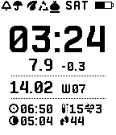

# Rat Scout — Dexcom CGM Watchface for Pebble

A feature-rich Pebble watchface that displays Dexcom continuous glucose monitoring (CGM) data alongside weather, astronomy, and daily life information.

https://apps.rePebble.com/bfecfeaed9de40ef9d929b66

## Overview

Rat Scout connects to the Dexcom Share API to display real-time blood glucose readings on your Pebble smartwatch. In addition to glucose tracking, it shows current time, date, week number, weather conditions (temperature, wind speed, umbrella indicator), sunrise/sunset and moonrise/moonset times, moon phase, step count, garbage collection schedule, and battery status — all on a single watchface.

## Features

### Glucose Monitoring
- **Real-time glucose display** with automatic 5-minute update cycle
- **Glucose delta**: rate of change (±) from previous reading
- **Time since reading**: minutes elapsed since last CGM data
- **Configurable units**: mg/dL or mmol/L
- **Threshold vibration alerts**: distinct vibration patterns for high and low BG
  - High: short-long pattern
  - Low: long-short pattern
  - One-shot: vibrates only on zone transition, not repeatedly
  - **Night thresholds**: optional separate thresholds during a configurable night window
- **Threshold sound alerts**: short melody when entering the low or high BG zone (Emery and Flint speaker)
  - Low: descending B minor arpeggio (F#4–D4–B3), played twice, triangle wave
  - High: the same arpeggio ascending (B3–D4–F#4)
  - Each toggle is independent of vibration; sounds can be enabled, disabled, and previewed separately
- **Multi-region Dexcom**: US, Outside-US (OUS), and Japan servers

### Weather (OpenWeatherMap)
- **Temperature & wind speed** in metric or imperial units
- **Umbrella indicator**: highlights when rain/snow is expected today (current conditions + 5-day forecast)
- **Smart caching**: configurable interval (30 min – 3 hours) with location-aware cache invalidation (>5 km change)

### Astronomy (ipgeolocation.io)
- **Sunrise/Sunset**: shows the next upcoming event; after sunset shows tomorrow's sunrise
- **Moonrise/Moonset**: handles both normal and inverted moon event ordering
- **Moon phase icon**: 8 phases (new → waxing crescent → … → waning crescent)
- **Daily cache**: fetched once per day, refreshes at midnight

### Time & Date
- **Time**: 12/24-hour format (follows system setting)
- **Date**: day.month format
- **Week number**: ISO week with "W" prefix
- **Weekday**: 3-letter abbreviation in status bar

### Status Bar
- **Hourly vibration indicator**: shows when hourly chime is enabled
- **Umbrella indicator**: highlights when rain is expected
- **Garbage collection**: underscores the next bag type (Organic / Grey / Black) based on weekly schedule, rolls over at 9 AM
### Quick View Alerts
- **Transient overlay banner**: appears at the bottom of the watchface after a BG threshold or hourly vibration fires
- **Icon-coded**: distinct icons for high/low BG alerts vs. hourly chime
- **Configurable duration**: Short (3 s), Normal (10 s), or Long (20 s)
- **Auto-dismiss**: overlay disappears after the chosen duration without interaction
- **Enable/disable**: can be toggled independently of vibration alerts
### Other
- **Battery indicator**: visual bar with charging animation
- **Step count**: daily steps from Pebble Health (on supported platforms)
- **Persistent state**: data persists across app restarts
- **Platforms**: Emery (Pebble Time 2) and Flint (Pebble 2 Duo)

### Plugin (preview)
The plugin pbw (`build/rat-scout-plugin.pbw`, see [Plugin pbw](#plugin-pbw-preview-sideload-only)) also contains a phone-side **plugin** that serves the latest Dexcom reading as `health/glucose` (glucose in your units and in mg/dL, delta, trend arrow and reading time), so other watchfaces, apps and Index can show it. It needs the **Pebble mobile app 1.16.x with the plugin preview enabled** (**Settings → Plugins → Plugins / permissions preview**; off by default). Without it, or with the regular `pebble build` pbw, Rat Scout fetches Dexcom directly exactly as before.

The plugin uses the Dexcom account entered in Rat Scout's settings; it calls Dexcom at most once every 55 s, reuses a reading until the next one is due (5 minutes), and pauses logins for 15 minutes if Dexcom refuses the password (an hour if Dexcom reports too many attempts), until you change the credentials. Design details: [.github/ARCHITECTURE.md](.github/ARCHITECTURE.md#plugin-preview--healthglucose).

> **Sideload only — do not publish.** Plugins are an unstable preview. Never publish a plugin pbw to the appstore (no `pebble publish`); install it only by sideloading.

## Requirements

- **Pebble 2 Duo or Pebble Time 2 smartwatch**
- **Dexcom Share account** with a connected CGM transmitter
- **Pebble/Rebble app** on your phone (the optional plugin needs Pebble app 1.16.x with the plugin preview enabled)
- **Internet connection** on phone for API access

## Configuration

Open Rat Scout settings from the Pebble/Rebble app on your phone.

### Dexcom Account
| Setting | Description |
|---------|-------------|
| Login | Dexcom Share account email/username |
| Password | Dexcom Share account password |
| Region | Dexcom server: Outside US (default), US, or Japan |

### Display
| Setting | Description |
|---------|-------------|
| BG Units | mg/dL or mmol/L |
| Show BG Delta | Toggle glucose rate of change |
| Show Time Delta | Toggle time since last reading |
| Date Format | dd.mm or mm.dd |

### Notifications
| Setting | Description |
|---------|-------------|
| Hourly Vibration | Double-pulse every hour on the hour |
| Hourly Sound | Two short C6 tones (125 ms each) every hour on the hour |
| BG Threshold Vibration | Enable/disable glucose threshold alerts |
| Low BG Threshold | Alert threshold in your preferred units |
| High BG Threshold | Alert threshold in your preferred units |
| Low Threshold Sound | Play descending alert melody when BG drops into the low zone |
| High Threshold Sound | Play ascending alert melody when BG rises into the high zone |
| Night Low Threshold | Optional low threshold during the night window |
| Night High Threshold | Optional high threshold during the night window |
| Night Start | Hour when night thresholds activate (0-23) |
| Night End | Hour when night thresholds deactivate (0-23) |
| Quick View Alerts | Show transient overlay banner after BG or hourly alerts |
| Alert Duration | Duration the overlay banner stays on screen: Short (3 s), Normal (10 s), Long (20 s) |

Night thresholds allow you to use different alerting ranges while you sleep (e.g., wider range to avoid unnecessary vibrations). If the night threshold fields are left empty or no night time frame is set, the general thresholds are used around the clock. The night window supports crossing midnight (e.g., start=22, end=7).

### Astronomy (Optional)
| Setting | Description |
|---------|-------------|
| API Key | ipgeolocation.io API key ([free signup](https://ipgeolocation.io/)) |

### Weather (Optional)
| Setting | Description |
|---------|-------------|
| API Key | OpenWeatherMap API key ([free signup](https://openweathermap.org/api)) |
| Units | Metric (°C, m/s) or Imperial (°F, mph) |
| Update Interval | 30 min, 1 hour, 2 hours, or 3 hours |

### Garbage Collection
| Setting | Description |
|---------|-------------|
| Pickup Time | Hour of day after which the next bag is shown (default 9) |
| Organic / Grey / Black Days | Weekdays each bag type is collected |

Every settings key, its default and its fallback: [scripts/settings.md](scripts/settings.md).

All settings are stored locally on your phone.

## Architecture

Main files (the full layout is in [.github/ARCHITECTURE.md](.github/ARCHITECTURE.md#repository-layout)):

```
src/
├── c/
│   ├── rat_scout.c          # Watchface core: UI, layer setup, vibration, persistent storage
│   ├── overlay.c            # Transient overlay notification banner (Quick View Alerts)
│   ├── glucose.c            # Glucose update rendering and BG threshold alert logic
│   ├── sounds.c             # Alert melodies (low/high BG, hourly chime)
│   ├── messaging.c          # AppMessage handler: settings ingestion, data dispatch
│   ├── draw_procs.c         # Custom GPath and drawing procedures
│   ├── layout.c             # Layer positioning and watchface layout
│   └── ui_helpers.c         # Shared UI utility functions
├── common/
│   └── dexcom_guard.js       # Dexcom login guard shared by the plugin and PKJS fallback
├── plugin-src/               # Plugin sources (main.js, xhr_shim.js)
├── plugin/index.js           # GENERATED plugin bundle (node scripts/build-plugin.js); never edit
└── pkjs/
    ├── index.js              # App orchestrator: settings, data fetching, message queue
    ├── dexcom.js             # Dexcom Share API client (auth + glucose readings)
    ├── glucose.js            # Glucose fetch + BG/delta formatting
    ├── glucose_plugin.js     # Chooses the plugin or direct Dexcom as the glucose source
    ├── weather.js            # OpenWeatherMap 2.5 API (current + forecast)
    ├── geolocation.js        # ipgeolocation.io astronomy API client
    ├── astronomy.js          # Astronomy time calculations (next sun/moon event logic)
    ├── garbage.js            # Garbage bag schedule
    ├── clay-config.js        # Clay test-button handlers
    └── config.json           # Clay settings UI definition
```

### Data Flow

```
Phone JS ─→ Dexcom Share API ─→ Parse glucose + calculate delta ─┐
         ─→ ipgeolocation.io ─→ Astronomy data (cached daily)   ─┤
         ─→ OpenWeatherMap   ─→ Weather data (cached per interval)─┤
                                                                   ├─→ Message Queue ─→ Pebble Watch
                                                Settings ──────────┘
```

With the plugin preview enabled on the phone, PKJS subscribes to Rat Scout's own plugin (`health/glucose`) instead of calling Dexcom itself, and falls back to the direct path if the plugin is unavailable, denied, failing, sends nothing within 30 s of subscribing, or is silent for more than 11 minutes (`src/pkjs/glucose_plugin.js`; modes and triggers in [.github/ARCHITECTURE.md](.github/ARCHITECTURE.md#glucose-source-selection-srcpkjsglucose_pluginjs)). When the plugin API is absent or does not list the plugin (including the legacy pbw), the direct path runs exactly as before. How a manifestVersion 2 pbw behaves on phone apps older than 1.16 is UNVERIFIED.

Glucose, weather and astronomy data are sent as separate messages. A message queue ensures only one `sendAppMessage` call is in flight at a time.

### Watchface Layout



## Development

### Dev Container

`.devcontainer/` provides everything needed on a fresh machine: Ubuntu 24.04 (the emulator needs glibc ≥ 2.38), Node.js, the emulator's runtime libraries, Xvfb/noVNC, `uv` and `pebble-tool`. On first start, `.devcontainer/setup.sh` downloads the latest Pebble SDK and runs `npm ci`; it is idempotent and can be re-run manually.

Outside the dev container, follow the [official SDK install guide](https://developer.repebble.com/sdk/) (`uv tool install pebble-tool`, `pebble sdk install latest`), then `npm ci`.

### Running in Emulator (Codespace / Local)

```bash
# Default (flint platform):
./scripts/run-emulator.sh

# Clean build first, specific platform, pre-seeded settings:
./scripts/run-emulator.sh --build --platform emery --settings scripts/settings.json

# Install the plugin pbw instead of the project build:
python3 -I scripts/pack-plugin.py && ./scripts/run-emulator.sh --pbw build/rat-scout-plugin.pbw

# See all options:
./scripts/run-emulator.sh --help
```

### Plugin smoke test (emulator)

```bash
./scripts/plugin-smoke.sh [--platform flint|emery] [--seconds N] [--keep-logs DIR]
```

Manual; not part of the test loop. Builds the plugin pbw and runs four cases on a freshly wiped emulator (`--seconds`, default 80 s each), checking the logs: no credentials (plugin mode, "---"), fake credentials with a seeded cached reading (served from cache, sent once, screenshot saved), fake credentials with no cache (login fails, "---", throttled), and the legacy pbw (direct mode). Every case runs with `HTTP(S)_PROXY` set to a closed local port and obviously fake credentials, so nothing reaches Dexcom. **Never try wrong passwords or failing logins against the real Dexcom service** (emulator or phone): Dexcom's lockout thresholds are UNVERIFIED and stay that way by decision. Login failures are tested only with a mocked fetch (`test/dexcom_guard.test.js`, `test/plugin.test.js`).

See [docs/noVNC.md](docs/noVNC.md) for viewing the emulator in a browser, stopping it, seeding Clay settings, fixing the location and taking screenshots.

The script streams logs from both sides once the app is running: lines prefixed `pkjs>` come from PebbleKit JS `console.log`, and lines prefixed `<file>.c:<line>>` come from C `APP_LOG`.

### Emulator Commands (headless)

In a container without a display, add `--vnc` to every command that uses `--emulator`:

```bash
pebble install --emulator flint --vnc                                  # start emulator + install
pebble screenshot --no-open --emulator flint --vnc screenshot.png      # save the screen as PNG
pebble logs --emulator flint --vnc                                     # stream C + JS logs
pebble emu-button click select --emulator flint --vnc                  # press a button
pebble kill && pebble wipe                                             # reset a stuck emulator
```

## Building

Requires Pebble SDK 4.x (tested with SDK 4.33.1 / pebble-tool 5.1.1 on Python 3.13). Settings UI uses [`@rebble/clay`](https://github.com/pebble-dev/clay), the maintained Clay fork with flint/emery support.

```bash
npm ci
pebble build
for f in test/*.test.js; do node "$f" || exit 1; done
pebble install --phone <phone_ip>
```

### Plugin pbw (preview, sideload only)

`pebble build` produces a **legacy** pbw (`build/work.pbw`, named after the checkout directory): SDK 4.33.1 has no plugin support, so the pbw has no `manifestVersion` and no plugin script, and the phone treats it exactly as before. To build the plugin pbw:

```bash
node scripts/build-plugin.js           # after editing src/plugin-src/, dexcom.js, glucose.js or dexcom_guard.js
node scripts/build-plugin.js --check   # exit 1 if src/plugin/index.js is stale
python3 -I scripts/pack-plugin.py      # clean build + build/rat-scout-plugin.pbw (manifestVersion 2 + src/plugin/index.js)
python3 -I scripts/pack-plugin.py --selftest   # packer self test on an in-memory pbw
pebble install --phone <phone_ip> build/rat-scout-plugin.pbw
```

`pack-plugin.py` refuses to run if `src/plugin/index.js` is stale, validates `definesPermissions`, and copies the pbw unchanged once a future SDK produces plugin-aware pbws itself; `--no-build` packs the existing build output. SDK 4.33.1 was the newest on the SDK server on 2026-10-30. The result is for sideloading only (see [Plugin (preview)](#plugin-preview)).

pebble-tool 5.1.1 runs `waf` with the SDK's own venv but passes its own `sys.path` as `PYTHONPATH` (`pebble_tool/commands/sdk/project/__init__.py`), so pebble-tool and the SDK venv must use the same Python minor version; otherwise `pebble build` fails with `SRE module mismatch`. Reinstall with `uv tool install --force --python <the SDK venv's python> pebble-tool==5.1.1`.

## Credits

- Dexcom API approach inspired by [pydexcom](https://github.com/gagebenne/pydexcom)
- Settings UI powered by [Pebble Clay](https://github.com/pebble/clay)
- Astronomy data by [ipgeolocation.io](https://ipgeolocation.io/)
- Weather data by [OpenWeatherMap](https://openweathermap.org/)

## Disclaimer

This is an unofficial, community-maintained project not affiliated with or endorsed by Dexcom, Inc. Always verify glucose readings with an official Dexcom receiver or app before making medical decisions. This watchface is a convenience tool only.

> **Credential storage notice:** Your Dexcom username and password are stored in plain text in the Pebble app's local storage on your phone. This is a limitation of the Pebble SDK and cannot be worked around. Your Dexcom Share credentials provide access to your full glucose history — treat them with the same care as any medical account password and ensure your phone is protected with a screen lock.