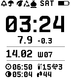

# Rat Scout — Dexcom CGM Watchface for Pebble

A feature-rich Pebble watchface that displays Dexcom continuous glucose monitoring (CGM) data alongside weather, astronomy, and daily life information.

https://apps.rePebble.com/bfecfeaed9de40ef9d929b66

## Overview

Rat Scout displays real-time Dexcom Share blood glucose readings on your Pebble smartwatch. The readings come from **Rat Scout Glucose**, a companion phone-side plugin (a separate pbw) that talks to Dexcom; the watchface itself never contacts Dexcom. In addition to glucose tracking, it shows current time, date, week number, weather conditions (temperature, wind speed, umbrella indicator), sunrise/sunset and moonrise/moonset times, moon phase, step count, garbage collection schedule, and battery status — all on a single watchface.

## Features

### Glucose Monitoring
- **Real-time glucose display** with automatic 5-minute update cycle; when the next reading is due the watch asks the phone once, 320 s after the last reading (timed to the second), then every minute up to 10 minutes after it if the reading is still missing, then every 5 minutes. No pings while the phone is out of reach, and one as soon as it reconnects. On the phone a new reading reached the watch 20–22 s after its Dexcom time with one watch ping per reading (30-minute run, 2026-11-05; before: 43–56 s)
- **Glucose delta**: rate of change (±) from previous reading
- **Time since reading**: minutes elapsed since last CGM data
- **Configurable units**: mg/dL or mmol/L
- **Threshold vibration alerts**: distinct vibration patterns for high and low BG
  - High: short-long pattern
  - Low: long-short pattern
  - One-shot: vibrates only on zone transition, not repeatedly. The zone is remembered across face restarts, so reopening the face while BG is still high or low doesn't alert again; after an hour without readings, a high or low alerts again
  - No alert for a reading 20 minutes or older (e.g. the last one, delivered after the phone was out of range): the watch shows "---" for it anyway
  - **Night thresholds**: optional separate thresholds during a configurable night window; the watch switches to them at the window's start and end (checked on every watch request, at least every 5 minutes)
- **Threshold sound alerts**: short melody when entering the low or high BG zone (Emery and Flint speaker)
  - Low: descending B minor arpeggio (F#4–D4–B3), played twice, triangle wave
  - High: the same arpeggio ascending (B3–D4–F#4)
  - Each toggle is independent of vibration; sounds can be enabled, disabled, and previewed separately
- **Multi-region Dexcom**: US, Outside-US (OUS), and Japan servers (set in the plugin)

### Weather (phone app weather plugin)
- **From the phone app's weather source** (`weather/location`): the plugin you chose for `weather/location` in the Pebble app (**Settings → Plugins → Preferred sources**; for example [MET Norway Weather](https://github.com/coredevices/pebble-plugins/tree/main/met-weather)), else the built-in Weather. The face never names a plugin, so plugins serving weather replace each other without a face update. Needs plugins enabled in the Pebble app (1.16.x or later) and the `Location` permission, which weather plugins require of their readers
- **Temperature & wind speed** in the units set in the Pebble app (built-in Preferences plugin, `preferences/units`: °C/°F; km/h, mph, m/s or knots). Each plugin says which unit its numbers are in (MET Norway: °C and m/s; built-in Weather: your temperature unit and mph), and the face converts them
- **Umbrella indicator**: on when it rains or snows now, in any hour left today, or today's chance of precipitation is above 30%
- **"--"** when no plugin serves the weather or the units, or the weather permission is denied. Other plugin errors keep the last weather. Unchanged weather isn't re-sent to the watch

### Astronomy (ipgeolocation.io)
- **Sunrise/Sunset**: shows the next upcoming event; after sunset shows tomorrow's sunrise
- **Moonrise/Moonset**: handles normal and inverted moon event ordering, and days with only a moonrise or only a moonset
- **Moon phase icon**: 8 phases (new → waxing crescent → … → waning crescent)
- **Daily cache**: fetched once per day, refreshes at midnight or when you move more than 5 km; after the API fails three times it waits 15 minutes before trying again

### Time & Date
- **Time**: 12/24-hour format (follows system setting)
- **Date**: day.month format
- **Week number**: ISO week with "W" prefix
- **Weekday**: 3-letter abbreviation in status bar
- Date, week and weekday follow a clock or time-zone change within a minute (not only at midnight)

### Status Bar
- **Hourly vibration indicator**: shows when hourly chime is enabled
- **Umbrella indicator**: highlights when rain is expected
- **Garbage collection**: underscores the next bag type (Organic / Grey / Black) based on weekly schedule, rolls over at 9 AM
### Quick View Alerts
- **Transient overlay banner**: appears at the bottom of the watchface after a BG threshold alert, or on the hour when the hourly vibration or hourly sound is on
- **Icon-coded**: distinct icons for high/low BG alerts vs. hourly chime
- **Configurable duration**: Short (3 s), Normal (10 s), or Long (20 s)
- **Auto-dismiss**: overlay disappears after the chosen duration without interaction
- **Enable/disable**: can be toggled independently of vibration alerts
### Other
- **Battery indicator**: visual bar with charging animation
- **Step count**: daily steps from Pebble Health (on supported platforms), shown at launch and updated every 5 minutes. The face declares the `Health` permission, which the phone doesn't enforce yet (plugins guide, "Permissions")
- **Persistent state**: data persists across app restarts
- **Platforms**: Emery (Pebble Time 2) and Flint (Pebble 2 Duo)

### Plugin (preview)
Rat Scout ships as two pbws (see [Plugin pbws](#plugin-pbws)):

- **Rat Scout Glucose** (`build/rat-scout-glucose.pbw`): a plugin-only pbw that serves the latest Dexcom reading as `health/glucose` (glucose in its own units and in mg/dL, delta, trend arrow and reading time), so Rat Scout, other watchfaces, apps and Index can show it. It holds the Dexcom account, set on its own settings page.
- **Rat Scout** (`build/rat-scout.pbw`): the watchface. It reads glucose only from the plugin; without it (not installed, preview off, permission not granted, or failing) the watch shows "---". There is no direct-Dexcom fallback.

Both need the **Pebble mobile app 1.16.x or later with plugins enabled** (**Settings → Plugins → Plugins / permissions preview**; off by default). Tested on 1.16.0.5 and 1.17.0.1 (Android).

The plugin reuses a reading until the next one is due (5 minutes), then calls Dexcom at most once every 12 s for about 2 minutes while it waits for the new reading (only with an existing Dexcom session; logins are never sped up), and at most once every 55 s otherwise. It pauses logins for 15 minutes if Dexcom refuses the password (an hour if Dexcom reports too many attempts), until you change the credentials. It keeps its Dexcom session when Dexcom just has no new reading, so it doesn't log in again on every poll. Design details: [.github/ARCHITECTURE.md](.github/ARCHITECTURE.md#plugin-preview--healthglucose).

> **Publishing is the owner's decision.** On 2026-11-05 Pebble announced plugins as live in the SDK and invited developers to upload them ([post](https://x.com/ericmigi/status/2118415004076756997)), while the [plugins guide](https://developer.repebble.com/guides/plugins/preview/) and the appstore's Plugins page still call them a (dev) preview and the guide still says not to publish yet. Don't run `pebble publish` for either pbw unless the owner asks; sideload for testing.

## Requirements

- **Pebble 2 Duo or Pebble Time 2 smartwatch**
- **Dexcom Share account** with a connected CGM transmitter
- **Pebble app 1.16.x or later** on your phone with plugins enabled (glucose comes from the Rat Scout Glucose plugin)
- **Internet connection** on phone for API access

## Setup

1. In the Pebble app, turn on **Settings → Plugins → Plugins / permissions preview**.
2. Sideload both pbws, the plugin first: `build/rat-scout-glucose.pbw`, then `build/rat-scout.pbw` (see [Plugin pbws](#plugin-pbws)).
3. Open **Apps → Plugins → Rat Scout Glucose → Settings**, enter the Dexcom login, password, region and units, and Save. Its page asks only for Internet access to the three Dexcom domains.
4. Approve "Read your glucose readings (via Rat Scout Glucose)" when the Pebble app asks on Rat Scout's behalf. Until then the face shows "---".

## Configuration

### Rat Scout Glucose (plugin settings page)
| Setting | Description |
|---------|-------------|
| Dexcom login | Dexcom Share account email/username |
| Dexcom password | Stored in the plugin's `Pebble.secureStorage`; never shown again ("Saved (leave empty to keep)") |
| Region | Dexcom server: Outside US (default), US, or Japan |
| Units | mg/dL or mmol/L, for the plugin's own `glucose`/`delta` values (Rat Scout's display uses its own BG Units) |

Saving asks the phone to refresh `health/glucose`. When the login, region or password changed, it also drops the plugin's Dexcom session and throttle, so the new account is tried at once; saving only the units keeps them. The plugin stores nothing derived from the password: a counter changes when you save a new one.

### Rat Scout (Clay settings)
Open Rat Scout settings from the Pebble app on your phone. It has no Dexcom fields; the "Glucose" section points to the plugin's settings page.

### Display
| Setting | Description |
|---------|-------------|
| BG Units | mg/dL or mmol/L |
| Show BG Delta | Toggle glucose rate of change (applies at once, without waiting for the next reading) |
| Show Time Delta | Toggle time since last reading |
| Date Format | dd.mm or mm.dd |

### Notifications
| Setting | Description |
|---------|-------------|
| Hourly Vibration | Double-pulse every hour on the hour |
| Hourly Sound | Two short C6 tones (125 ms each) every hour on the hour |
| BG Threshold Vibration | Enable/disable glucose threshold alerts |
| Low BG Threshold | Alert threshold in your preferred units |
| High BG Threshold | Alert threshold in your preferred units |
| Low Threshold Sound | Play descending alert melody when BG drops into the low zone |
| High Threshold Sound | Play ascending alert melody when BG rises into the high zone |
| Night Low Threshold | Optional low threshold during the night window |
| Night High Threshold | Optional high threshold during the night window |
| Night Start | Hour when night thresholds activate (0-23) |
| Night End | Hour when night thresholds deactivate (0-23) |
| Quick View Alerts | Show transient overlay banner after BG or hourly alerts |
| Alert Duration | Duration the overlay banner stays on screen: Short (3 s), Normal (10 s), Long (20 s) |

Night thresholds allow you to use different alerting ranges while you sleep (e.g., wider range to avoid unnecessary vibrations). If the night threshold fields are left empty or no night time frame is set, the general thresholds are used around the clock. The night window supports crossing midnight (e.g., start=22, end=7).

### Astronomy (Optional)
| Setting | Description |
|---------|-------------|
| API Key | ipgeolocation.io API key ([free signup](https://ipgeolocation.io/)) |

### Garbage Collection
| Setting | Description |
|---------|-------------|
| Pickup Time | Hour of day after which the next bag is shown (default 9) |
| Organic / Grey / Black Days | Weekdays each bag type is collected |

Every settings key, its default and its fallback: [scripts/settings.md](scripts/settings.md).

All settings are stored locally on your phone, separately per pbw: Rat Scout's in its `clay-settings`, the plugin's in its own storage. On start, Rat Scout deletes the Dexcom login, password and region and the Dexcom session keys that older versions left in its storage (`src/pkjs/legacy_cleanup.js`).

## Architecture

Main files (the full layout is in [.github/ARCHITECTURE.md](.github/ARCHITECTURE.md#repository-layout)):

```
src/
├── c/
│   ├── rat_scout.c          # Watchface core: UI, layer setup, vibration, persistent storage
│   ├── overlay.c            # Transient overlay notification banner (Quick View Alerts)
│   ├── glucose.c            # Glucose update rendering and BG threshold alert logic
│   ├── sounds.c             # Alert melodies (low/high BG, hourly chime)
│   ├── messaging.c          # AppMessage handler: settings ingestion, data dispatch, fetch pings
│   ├── draw_procs.c         # Custom GPath and drawing procedures
│   ├── layout.c             # Layer positioning and watchface layout
│   └── ui_helpers.c         # Shared UI utility functions
├── plugin-src/               # Rat Scout Glucose sources, bundled into plugin/plugin.js
│   ├── main.js               # health/glucose source handler, cache, throttle, settings-page handler
│   ├── settings.js           # Plugin settings: localStorage + secureStorage (password)
│   ├── dexcom.js             # Dexcom Share API client (auth + glucose readings)
│   ├── dexcom_guard.js       # Dexcom login guard
│   └── xhr_shim.js           # XMLHttpRequest subset on fetch
└── pkjs/
    ├── index.js              # App orchestrator: settings, data fetching
    ├── message_queue.js      # Watch message queue (one in flight, 30 s timeout) and change filter
    ├── watch_settings.js     # Settings dictionary: night thresholds, garbage bag
    ├── glucose.js            # BG/delta formatting (also bundled into the plugin)
    ├── glucose_plugin.js     # Subscribes to the plugin; unavailable/pending/plugin modes
    ├── legacy_cleanup.js     # Purges Dexcom data older versions stored in the face
    ├── weather_plugin.js     # Subscribes to weather/location and preferences/units
    ├── permissions.js        # Logs permission states (Pebble.permissions.query)
    ├── geolocation.js        # ipgeolocation.io astronomy API client
    ├── astronomy.js          # Astronomy time calculations (next sun/moon event logic)
    ├── garbage.js            # Garbage bag schedule
    ├── clay-config.js        # Clay test-button handlers
    └── config.json           # Clay settings UI definition
plugin/                       # The Rat Scout Glucose pbw (plugin-only)
├── package.json              # Its manifest: own uuid, Dexcom domains, plugin block, configPage
├── wscript                   # SDK build rules for a plugin-only project
├── plugin.js                 # GENERATED bundle (node scripts/build-plugin.js); never edit
└── config.html               # Its settings page (Dexcom account, units)
```

### Data Flow

```
Rat Scout Glucose plugin ─→ Dexcom Share API ─→ health/glucose envelope ─┐
Phone JS (face) ─→ subscription to the plugin ─→ glucose dictionary  ←───┘ ─┐
                ─→ ipgeolocation.io ─→ Astronomy data (cached daily)          ─┤
                ─→ weather/location + preferences/units ─→ weather dictionary ─┤
                                                                               ├─→ Message Queue ─→ Pebble Watch
                                                            Settings ──────────┘
```

PKJS subscribes to the Rat Scout Glucose plugin (`health/glucose`) and shows "---" (mode `unavailable`) when the plugin API is absent, the plugin isn't listed, the permission is denied, the plugin fails, sends nothing within 30 s of subscribing, or is silent for more than 11 minutes. One transient error keeps the shown reading; a second leads to "---". While unavailable without a subscription it checks for the plugin again on every watch request (at least every 5 minutes), so installing the plugin or turning the preview on while the face runs switches to it without restarting the face. When a reading is due (5 minutes old), each watch request resubscribes, which makes the phone run the plugin at once instead of at its next poll (the phone's 60 s poll counts only time the phone is awake and was seen to take about 6 minutes). Up to 435 s after the last reading it does this at most every 12 s (so the watch's one ping at +320 s isn't held back by a host poll just before it), later at most about once a minute; the plugin's cache and throttle bound Dexcom calls (one per 12 s while the reading is due and a session exists, else one per 55 s) (`src/pkjs/glucose_plugin.js`; modes and triggers in [.github/ARCHITECTURE.md](.github/ARCHITECTURE.md#glucose-source-selection-srcpkjsglucose_pluginjs)). How a manifestVersion 2 pbw behaves on phone apps older than 1.16 is UNVERIFIED.

Weather comes from two subscriptions that name no plugin, so the phone picks the provider: `weather/location` (the plugin chosen for it in **Settings → Plugins → Preferred sources**, else the built-in Weather) and `preferences/units` (built-in Preferences). The face converts each plugin's numbers from the unit it reports into the app's units, sends "--" while either source has no plugin or the weather permission is denied, checks for a missing source on every watch request, and subscribes again at once when the phone retires the serving plugin (another plugin chosen, or the plugin updated or removed). Each answer is logged as `Weather data: plugin=<name> temperature=<value> <unit> wind=<value> <unit>` and `Weather units: plugin=<name> temperature=<unit> wind=<unit>` (no place names or coordinates; `src/pkjs/weather_plugin.js`). A change of the preferred source reaches the face when it subscribes again, e.g. when the face restarts (phone-verified on 1.16.0.5 and 1.17.0.1: the open subscription stays on the old plugin). The app's Settings → Weather → "Weather provider" sets the same preference. On start, and when a source answers `PERMISSION_DENIED`, the face logs the state of its `Glucose` and `Location` permissions (`Pebble.permissions.query`, `src/pkjs/permissions.js`): `granted`, waiting for approval, or turned off.

Glucose, weather and astronomy data are sent as separate messages. A message queue (`src/pkjs/message_queue.js`) keeps one `sendAppMessage` call in flight at a time; a send with no answer within 30 s counts as failed and the queue moves on. Weather and astronomy are sent only when they changed (a failed send is retried on the next watch request); a glucose message whose send failed is also resent on the next watch request. The settings message is re-sent when the night thresholds or the garbage bag change with the time of day. While glucose shows "---" with the subscription still open (no data for 11 minutes, the plugin failing), the face resubscribes every 5 minutes, except while the Glucose permission is waiting for your approval; saving Rat Scout's settings also retries a plugin that rejected the request.

### Watchface Layout



## Development

### Dev Container

`.devcontainer/` provides everything needed on a fresh machine: Ubuntu 24.04 (the emulator needs glibc ≥ 2.38), Node.js, the emulator's runtime libraries, Xvfb/noVNC, `uv` and `pebble-tool`. On first start, `.devcontainer/setup.sh` downloads the latest Pebble SDK and runs `npm ci`; it is idempotent and can be re-run manually.

Outside the dev container, follow the [official SDK install guide](https://developer.repebble.com/sdk/) (`uv tool install pebble-tool`, `pebble sdk install latest`), then `npm ci`.

### Running in Emulator (Codespace / Local)

```bash
# Default (flint platform):
./scripts/run-emulator.sh

# Clean build first, specific platform, pre-seeded settings:
./scripts/run-emulator.sh --build --platform emery --settings scripts/settings.json

# Install the watchface pbw the packer copies to a fixed name
# (install build/rat-scout-glucose.pbw with `pebble install --emulator` for glucose):
python3 -I scripts/pack-plugin.py && ./scripts/run-emulator.sh --pbw build/rat-scout.pbw

# See all options:
./scripts/run-emulator.sh --help
```

### Plugin smoke test (emulator)

```bash
./scripts/plugin-smoke.sh [--platform flint|emery] [--seconds N] [--keep-logs DIR]
```

Manual; not part of the test loop. Builds both pbws and runs four cases on a freshly wiped emulator (`--seconds`, default 80 s each). Each case seeds the plugin's localStorage and its secureStorage file (`plugin-secure-storage/<plugin uuid>.json`, for the password), installs the plugin pbw, then installs the face pbw with logs and checks them: no account (plugin mode, "---"), a fake account with a seeded cached reading (served from cache, sent once, screenshot saved; on flint it shows 6.7 +0.3), a fake account with no cache (login fails, "---", throttled), and no plugin installed (unavailable, "---", no subscription, no Dexcom request). Lines the face logs at `ready` can precede the log stream, so no check relies on them. Every case runs with `HTTP(S)_PROXY` set to a closed local port and obviously fake credentials, so nothing reaches Dexcom. **Never try wrong passwords or failing logins against the real Dexcom service** (emulator or phone): Dexcom's lockout thresholds are UNVERIFIED and stay that way by decision. Login failures are tested only with a mocked fetch (`test/dexcom_guard.test.js`, `test/plugin.test.js`).

For developing plugins with the current app, SDK and tools (versions, the Android sandbox, packaging, testing, pitfalls), see [docs/plugins.md](docs/plugins.md).

### Plugin check on a real phone

```bash
./scripts/device-check.sh steps                       # the checklist: operator action + command per step
./scripts/device-check.sh login                       # prints a sign-in URL, waits for the callback
./scripts/device-check.sh callback 'http://localhost:60000/?...'
./scripts/device-check.sh install glucose               # the plugin pbw first
./scripts/device-check.sh install face --expect plugin [--seconds N]
./scripts/device-check.sh logs --seconds 1800 --expect plugin
./scripts/device-check.sh screenshot
```

Needs the Pebble mobile app 1.16.x or later with plugins enabled. `install face|glucose` builds both pbws (`pack-plugin.py`) and installs `build/rat-scout.pbw` or `build/rat-scout-glucose.pbw`. Each command installs or captures logs for `--seconds` (default 120), running pebble from an empty temporary directory (pebble-tool 5.1.1/5.1.2 can crash on a PKJS log that arrives while it loads the project's sourcemap), then summarises the watch (C), `pkjs>` and `plugin>` log lines: the glucose modes seen, plugin envelopes, gate sends, duplicates the gate skipped, Dexcom logins and reading fetches, plugin error codes, overdue resubscribes, permission and crash lines, and for each new reading the delay from its Dexcom time to the send (log times read as UTC), readings skipped between sends, and reading fetches per new reading. It fails on a crash, on the plugin path resending the last reading, when the final mode differs from `--expect`, when it never reaches `Connected.` (the developer connection is off or the Pebble app isn't running), or when pebble stops before `--seconds` (the phone's developer connection dropped: pebble prints `Disconnected.` and exits; or it failed at once, e.g. not logged in). `analyze` on a saved log warns about a `Disconnected.` line.

- **Transport:** the CloudPebble proxy by default (`pebble --phone` with no IP), which works when this machine can't reach the phone. It needs `pebble login`. In a container your browser can't reach, run `login`, open the URL, then paste the `http://localhost:60000/?...` address the browser fails to load into `callback`. With a reachable phone use `--phone-ip IP`; on Android over USB use `--adb`.
- **Privacy:** logs are written to `.device-check/` (gitignored; not under `build/`, which the packer cleans), with UUIDs other than the app's, email addresses and IPv4 addresses with a port or in a URL masked; `REDACT=word1,word2` masks more (e.g. a Dexcom login that isn't an email address). The app never logs Dexcom account or session IDs or device coordinates.
- **Safety:** this uses the real Dexcom account set on the plugin's settings page. The wrong-password step stays off-device (mocked unit tests only).

See [docs/noVNC.md](docs/noVNC.md) for viewing the emulator in a browser, stopping it, seeding Clay settings, fixing the location and taking screenshots.

The script streams logs from both sides once the app is running: lines prefixed `pkjs>` come from PebbleKit JS `console.log`, and lines prefixed `<file>.c:<line>>` come from C `APP_LOG`.

### Emulator Commands (headless)

In a container without a display, add `--vnc` to every command that uses `--emulator`:

```bash
pebble install --emulator flint --vnc                                  # start emulator + install
pebble screenshot --no-open --emulator flint --vnc screenshot.png      # save the screen as PNG
pebble logs --emulator flint --vnc                                     # stream C + JS logs
pebble emu-button click select --emulator flint --vnc                  # press a button
pebble kill && pebble wipe                                             # reset a stuck emulator
```

## Building

Requires Pebble SDK 4.44 or later (plugin support; tested with SDK 4.44 / pebble-tool 5.1.2 on Python 3.13). Settings UI uses [`@rebble/clay`](https://github.com/pebble-dev/clay), the maintained Clay fork with flint/emery support.

```bash
npm ci
pebble build
for f in test/*.test.js; do node "$f" || exit 1; done
```

`pebble build` in the project root builds the watchface (`build/<checkout dir>.pbw`, `manifestVersion: 2`, SDK 4.44's default). The plugin is a separate SDK project in `plugin/` (`projectType: "plugin"`, `plugin/wscript`). Both builds show warnings that are harmless: the linker's "LOAD segment with RWX permissions" (also with SDK 4.33.1) and, for the plugin, "feature 'message_keys' does not exist".

### Plugin pbws

To build both pbws:

```bash
node scripts/build-plugin.js           # after editing src/plugin-src/ or src/pkjs/glucose.js
node scripts/build-plugin.js --check   # exit 1 if plugin/plugin.js is stale
python3 -I scripts/pack-plugin.py      # clean builds of both projects + build/rat-scout.pbw and build/rat-scout-glucose.pbw
pebble install --phone <phone_ip> build/rat-scout-glucose.pbw   # the plugin first
pebble install --phone <phone_ip> build/rat-scout.pbw
```

- `build/rat-scout.pbw`: copy of the root `pebble build` output (`manifestVersion: 2`, which a watchapp needs to read plugins), no plugin.
- `build/rat-scout-glucose.pbw`: copy of `plugin/build/plugin.pbw`: `appinfo.json`, `plugin.js` and `config.html`, no watch binary. SDK 4.44 bundles the script and the local `configPage` and validates the `plugin` block when the project is configured.

`pack-plugin.py` refuses to run if `plugin/plugin.js` is stale, runs `pebble clean` + `pebble build` in both projects, refuses a pbw that isn't `manifestVersion: 2` (built with an SDK older than 4.44), and copies both to the fixed names that `device-check.sh`, `plugin-smoke.sh` and `run-emulator.sh` use; `--no-build` copies the existing build outputs. Publishing: see [Plugin (preview)](#plugin-preview).

pebble-tool 5.1.x runs `waf` with the SDK's own venv but passes its own `sys.path` as `PYTHONPATH` (`pebble_tool/commands/sdk/project/__init__.py`), so pebble-tool and the SDK venv must use the same Python minor version; otherwise `pebble build` fails with `SRE module mismatch`. Reinstall with `uv tool install --force --python <the SDK venv's python> pebble-tool==5.1.2`.

## Credits

- Dexcom API approach inspired by [pydexcom](https://github.com/gagebenne/pydexcom)
- Settings UI powered by [Pebble Clay](https://github.com/pebble/clay)
- Astronomy data by [ipgeolocation.io](https://ipgeolocation.io/)
- Weather data from the Pebble app's weather plugin (for example [MET Norway](https://api.met.no/) via MET Norway Weather)

## Disclaimer

This is an unofficial, community-maintained project not affiliated with or endorsed by Dexcom, Inc. Always verify glucose readings with an official Dexcom receiver or app before making medical decisions. This watchface is a convenience tool only.

> **Credential storage notice:** Your Dexcom password is stored in the Rat Scout Glucose plugin's `Pebble.secureStorage` on your phone, which only that plugin can read (the Pebble plugins preview guide says the phone's keystore encrypts it; not independently verified). Your Dexcom login and region are in the plugin's plain localStorage. Older Rat Scout versions kept all three in plain text in the watchface's settings; the current watchface deletes them on start. Your Dexcom Share credentials provide access to your full glucose history — treat them with the same care as any medical account password and ensure your phone is protected with a screen lock.